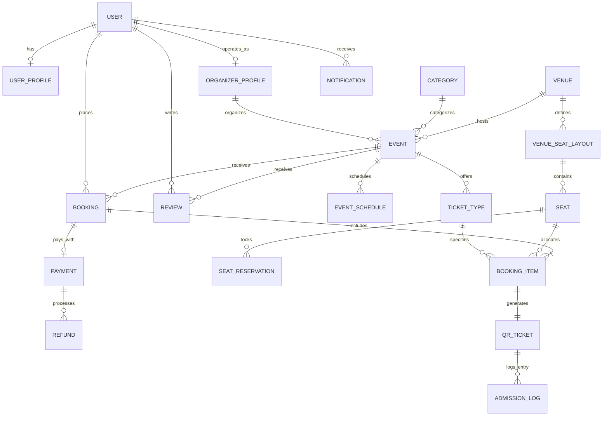

# MORROW - Entity Relationship Diagram (ERD)

## Conceptual Entity Relationship Diagram

---

## Cardinality & Key Relationship Highlights

1. **User to Organizer Profile (1:0..1):** A user account may upgrade and register as an approved event organizer.
2. **Event to Ticket Types (1:N):** An event can offer multiple pricing tiers (e.g., Early Bird, VIP, Balcony).
3. **Venue to Seats (1:N):** Venues define fixed physical seating geometry or open-standing capacities.
4. **Booking to Booking Items (1:N):** One checkout transaction can contain tickets for multiple attendees or seats.
5. **Booking Item to QR Ticket (1:1):** Every individual admitted ticket receives its own distinct, cryptographically signed QR token to prevent credential sharing.
6. **QR Ticket to Admission Logs (1:N):** Tracks all scan attempts at the gate (admissions, timestamped duplicate scan flags).

